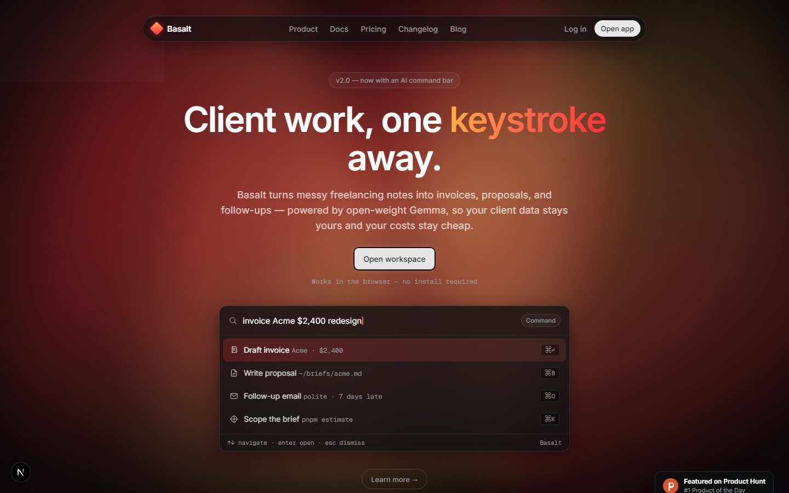
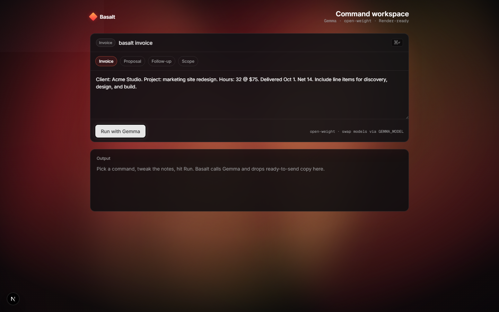
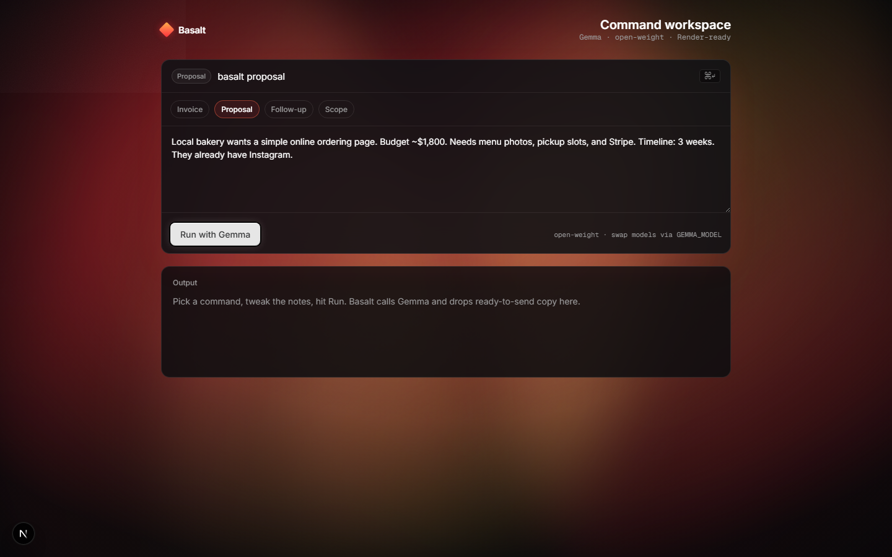
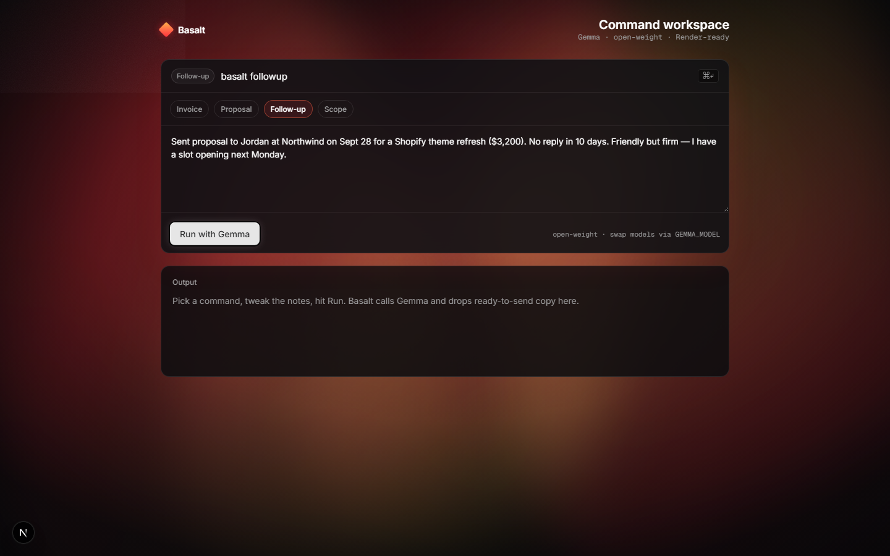
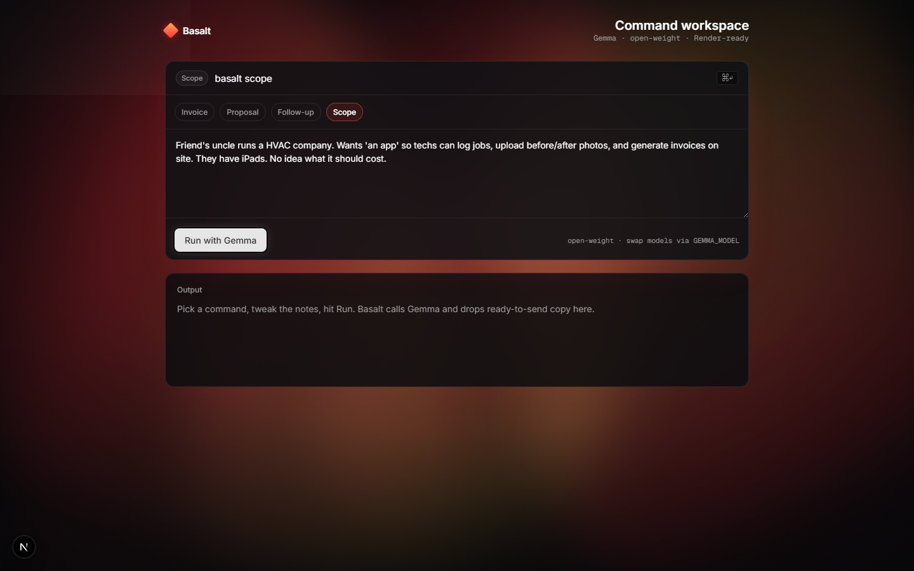

<div align="center">

# Basalt

**Freelancer command bar powered by open-weight Gemma.**

Basalt turns messy client notes into invoices, proposals, follow-ups, and scoped briefs — in one command. Built for the [Hacktoberfest Open-Source AI Challenge: Week 2 — Side Hustle](https://dev.to/challenges/hacktoberfest-week2-2026-10-12).

[](https://nextjs.org/)
[](https://ai.google.dev/gemma)
[](https://render.com/)
[](LICENSE)

</div>

---

## Why Basalt?

Freelancers rewrite the same invoices, proposals, and chase emails every week. Closed chatbots work until client data, cost, or lock-in gets in the way.

Basalt keeps the workflow in a focused **command bar** and uses **Gemma** (Google’s open-weight model) so you can:

- Swap model size via `GEMMA_MODEL` without rewriting the product  
- Point the same prompts at a local Gemma later (Ollama / Edge)  
- Keep pricing predictable for a tool someone would actually pay for  

---

## Screenshots

### Landing



### Workspace — Invoice



### Workspace — Proposal



### Workspace — Follow-up



### Workspace — Scope



---

## Features

| Command | What it does |
| --- | --- |
| **Invoice** | Line items, totals placeholders, payment terms from rough notes |
| **Proposal** | Short client proposal: approach, deliverables, timeline, price |
| **Follow-up** | Polite chase email with subject line |
| **Scope** | Goals, out-of-scope, assumptions, rough effort/price band |

Also included:

- Cinematic dark landing hero with a living warm aurora (CSS-only)  
- Dark-glass command-bar UI in the product workspace  
- Copy-ready output panel  
- Render Blueprint (`render.yaml`) for one-click style deploy  

---

## Tech stack

| Layer | Choice |
| --- | --- |
| Framework | **Next.js 15** (App Router) |
| Language | **TypeScript** |
| UI | Custom CSS (Inter + Geist Mono) — no purple “AI slop” palette |
| AI | **Gemma** via `@google/generative-ai` (Google AI Studio) |
| Hosting | **Render** (`render.yaml` web service) |
| Package manager | npm |

### Project layout

```
src/
  app/
    page.tsx              # Landing hero
    workspace/page.tsx    # Live command workspace
    api/generate/route.ts # Gemma generation API
  components/             # Aurora, workspace UI, icons
  lib/commands.ts         # Command prompts
screenshots/              # Demo images for docs & DEV post
render.yaml               # Render Blueprint
```

---

## Challenge tracks

| Track | How Basalt uses it |
| --- | --- |
| **Best Use of Gemma** | All generation runs through open-weight Gemma (`gemma-3-12b-it` by default) |
| **Best Use of Render** | Deployed as a Node web service via `render.yaml` |

Tags for the DEV submission: `#devchallenge` `#hf26challenge`

---

## Quick start

### 1. Clone

```bash
git clone https://github.com/nonsense3/Basalt.git
cd Basalt
npm install
```

### 2. Environment

```bash
cp .env.example .env
```

Edit `.env`:

```env
GOOGLE_AI_API_KEY=your_key_from_aistudio
GEMMA_MODEL=gemma-3-12b-it
```

Get a free key at [Google AI Studio](https://aistudio.google.com/apikey).

### 3. Run

```bash
npm run dev
```

- Landing: [http://localhost:3000](http://localhost:3000)  
- Workspace: [http://localhost:3000/workspace](http://localhost:3000/workspace)  

---

## Deploy on Render

1. Push this repo (already done if you’re reading this on GitHub).  
2. [Render](https://render.com/) → **New** → **Blueprint** → select this repo.  
3. Set `GOOGLE_AI_API_KEY` in the Render dashboard.  
4. Deploy.

Or create a **Web Service** manually:

| Setting | Value |
| --- | --- |
| Build | `npm install && npm run build` |
| Start | `npm run start` |
| Env | `GOOGLE_AI_API_KEY`, optional `GEMMA_MODEL` |

Hacktoberfest Render credits (if available): [hacktoberfest.com/my](https://hacktoberfest.com/my)

---

## Environment variables

| Variable | Required | Description |
| --- | --- | --- |
| `GOOGLE_AI_API_KEY` | Yes | Google AI Studio API key |
| `GEMMA_MODEL` | No | Default `gemma-3-12b-it`. Also try `gemma-3-4b-it` or `gemma-3-27b-it` |

---

## Scripts

| Command | Description |
| --- | --- |
| `npm run dev` | Local development |
| `npm run build` | Production build |
| `npm run start` | Serve production build |
| `npm run lint` | ESLint |

---

## License

MIT — see [LICENSE](LICENSE).

---

Built for freelancers who’d rather bill than rewrite the same email for the tenth time.
